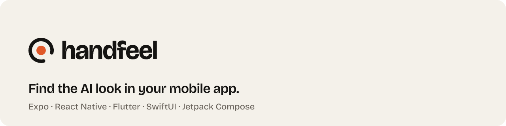
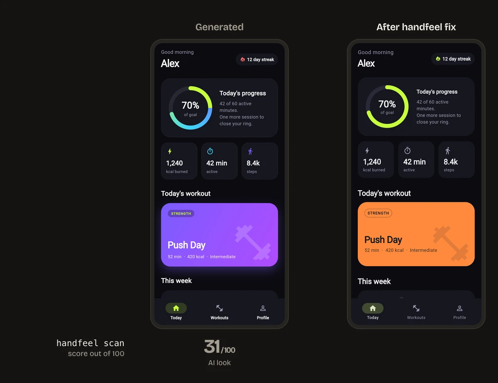
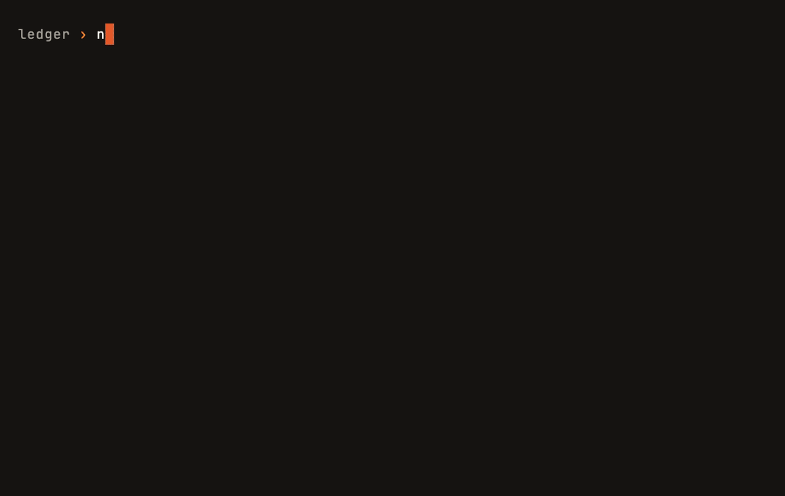
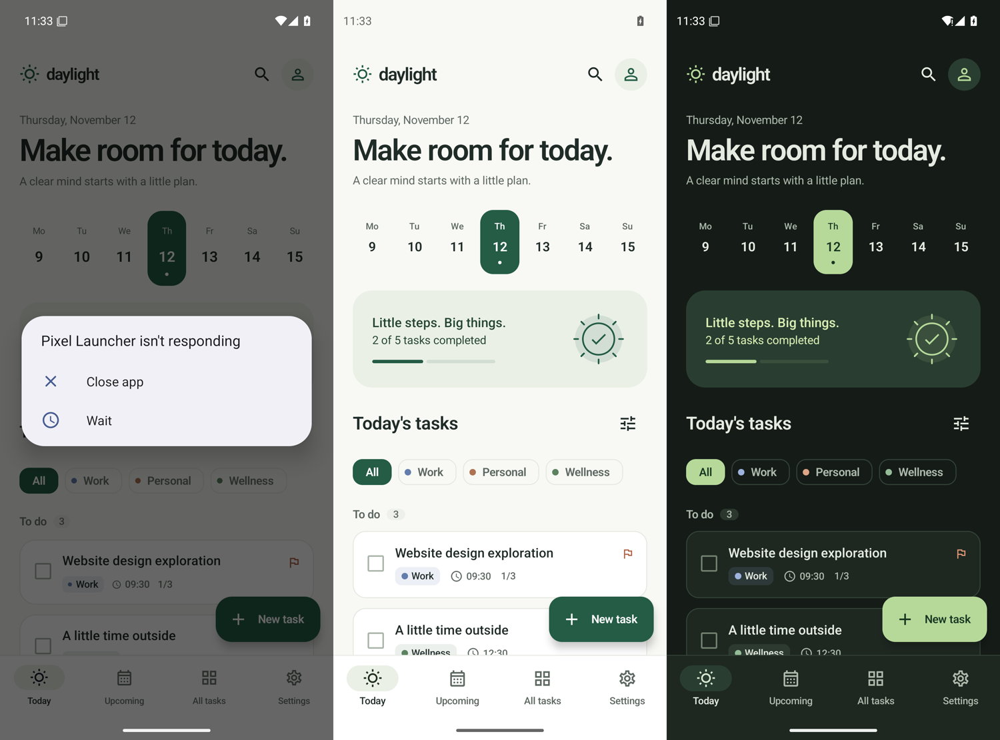

<p align="center">
  <picture>
    <source media="(prefers-color-scheme: dark)" srcset="https://raw.githubusercontent.com/maximilianfeix/handfeel/main/brand/banners/readme-banner-dark.png">
    
  </picture>
</p>

<p align="center">
  A scanner that scores Expo / React Native, Flutter, SwiftUI and Jetpack Compose code from 0 to 100,<br>
  and an agent skill that fixes what it finds.
</p>

<p align="center">English · <a href="https://github.com/maximilianfeix/handfeel/blob/main/README.zh-CN.md">简体中文</a></p>

<p align="center">
  
</p>

```sh
npx handfeel scan .          # every finding as file:line. No AI, no network
npx handfeel scan --demo     # try it on an app Claude generated
```

| Now in Android | Reply | Ice Cubes | Compass | Wonderous | Bluesky | Apps generated by Claude and Codex |
|---:|---:|---:|---:|---:|---:|---:|
| 94 | 92 | 91 | 87 | 85 | 76 | 31 to 79 |

Generated apps miss the same things: taps that show nothing, 28-point buttons, no haptics, a font size per label, white screens at night, and the indigo gradient. Every rule quotes Apple's HIG, Material 3 or the framework docs, and the scanner was [calibrated on nine open-source apps](https://github.com/maximilianfeix/handfeel/blob/main/docs/real-apps.md) so well-made apps don't get punished.

## Fix it with your agent

```sh
npx skills add maximilianfeix/handfeel        # Claude Code, Codex and other agents that read .agents/skills
npx handfeel init cursor                      # Cursor: writes .cursor/rules/handfeel.mdc
```

Claude Code plugin instead: `/plugin marketplace add maximilianfeix/handfeel`, then `/plugin install handfeel@handfeel`.

Then ask your agent: *"audit this app with handfeel"* (report only, `file:line` per finding) or *"use handfeel to fix the screens"* (small changes, one screen and one pass at a time: touch, structure, color, type, icons, spacing, platform details). It never removes features, screens or flows, and it asks before changing navigation or adding a dependency.

## What it fixes

Eight of the patterns, each taken from the [platform references](https://github.com/maximilianfeix/handfeel/tree/main/skills/handfeel/references/). Every rule there has the slop, the fix, and the quoted source.

**Taps that show nothing** (Expo / React Native, `no-press-feedback`)

```diff
- <Pressable onPress={() => open(item)}>
+ <Pressable
+   onPress={() => open(item)}
+   android_ripple={{ color: c.ripple }}
+   style={({ pressed }) => ({ backgroundColor: pressed && Platform.OS === 'ios' ? c.highlight : 'transparent' })}
+ >
```

**A gradient pill with `onTapGesture`** (SwiftUI, `no-press-feedback`)

```diff
- Text("Save")
-     .background(LinearGradient(colors: [.purple, .blue], startPoint: .leading, endPoint: .trailing))
-     .cornerRadius(16).shadow(radius: 10)
-     .onTapGesture { save() }
+ Button("Save", action: save)
+     .buttonStyle(.borderedProminent)
+     .controlSize(.large)
```

**A 20 dp touch target** (Jetpack Compose, `touch-target-too-small`)

```diff
- Icon(Icons.Default.Close, null, Modifier.size(20.dp).clickable { onClose() })
+ IconButton(onClick = onClose) {
+     Icon(Icons.Default.Close, contentDescription = stringResource(R.string.close))
+ }
```

**A form in a dialog** (Flutter, `modal-instead-of-sheet`)

```diff
- showDialog(context: context, builder: (_) => AlertDialog(content: form));
+ showModalBottomSheet(context: context, showDragHandle: true, useSafeArea: true,
+     isScrollControlled: true, builder: (_) => form);
```

**Silent selection** (Flutter, `no-haptics`)

```diff
- GestureDetector(onTap: () => setState(() => selected = i), child: Segment(label))
+ InkWell(
+   onTap: () { HapticFeedback.selectionClick(); setState(() => selected = i); },
+   child: Segment(label),
+ )
```

**Emoji as icons** (Expo / React Native, `emoji-as-icon`)

```diff
- <Text style={{ fontSize: 22 }}>{'\u{1F3E0}'}</Text>   // house emoji as the Home tab icon
+ <SymbolView name={{ ios: 'house.fill', android: 'home' }} size={24} tintColor={c.text} />
```

**The default purple gradient** (Flutter, `purple-gradient`)

```diff
- gradient: LinearGradient(colors: [Color(0xFF667EEA), Color(0xFF764BA2)]),
+ color: Theme.of(context).colorScheme.surfaceContainerHigh,
```

**A point size per label** (SwiftUI, `fixed-font-size`)

```diff
- Text("Good morning").font(.system(size: 34, weight: .ultraLight))
- Text(title).font(.custom("Inter-Bold", fixedSize: 28))
+ Text("Good morning").font(.largeTitle)
+ Text(title).font(.custom("Inter-Bold", size: 28, relativeTo: .title))
```

The skill also covers what a scanner can't see: hierarchy, copy, empty and loading states, motion and Reduce Motion. The full list of tells is in [signs.md](https://github.com/maximilianfeix/handfeel/blob/main/skills/handfeel/references/signs.md).

## The scanner

<p align="center"></p>

```sh
npx handfeel scan .                 # score and every finding as file:line
npx handfeel scan --demo            # try it on a bundled generated Flutter app
npx handfeel scan . --card score.svg   # also write a 1200x630 score card to share
npx handfeel scan . --json          # or --sarif (GitHub code scanning), --md (PR comments)
npx handfeel rules                  # all 27 rules with weight and cap
npx handfeel explain no-haptics     # why the rule exists, how to fix it, sources
npx handfeel badge .                # a README badge with your score
```

Share a result: `--card score.svg` writes a 1200x630 card with the score and the three rules that cost the most, and `npx handfeel badge .` prints a badge like [](https://github.com/maximilianfeix/handfeel) for your README.

It reads source files and nothing else: no network, no AI calls, no code execution. React Native files go through a Babel AST; Dart, Swift and Kotlin use tested pattern rules. The same code gives the same score every time.

```text
  handfeel 0.1.0  ·  Expo / React Native  ·  14 files

   51 / 100   looks generated

  where the points went
    -10  purple-gradient       2 found
    -10  no-dark-mode          1 found
   -9.5  hardcoded-color       19 found
     -8  no-press-feedback     4 found
     -6  glassmorphism         4 found, 1 free
     -3  type-scale-sprawl     11 found, 8 free
     -2  icon-button-no-label  2 found
      0  gradient-overuse      2 found, 2 free

  app/(tabs)/index.tsx
    32:7    purple-gradient       Gradient uses #8E5CF0, the indigo/violet band generated UIs default to.
    88:86   glassmorphism         rgba(255,255,255,0.3) is a frosted-glass fill.
  app/(tabs)/budgets.tsx
    85:7    icon-button-no-label  Pressable contains only an icon and has no accessibilityLabel.
    ...
```

### How the score works

Each rule has a weight per finding, a cap, and sometimes a few free findings:

```text
score = floor(100 − Σ min(cap, weight × (count − free)))
```

In projects with more than 20 files, per-finding rules count findings per 20 files (`count × 20 / files`), because the weights were set on small apps and a 2,000-file app has more of everything. Project-wide rules and turned-off font scaling are not scaled.

A single noisy rule can't sink the score, and the breakdown shows where every point went. 90 and up reads "feels native", 75 "almost there", 50 "looks generated", below that "AI look". A score of 100 means the scanner found nothing it knows how to find. It does not mean the app is well designed.

### How real apps score

Nine well-known open-source apps, scanned on 2026-11-12 at the commits in [docs/real-apps.md](https://github.com/maximilianfeix/handfeel/blob/main/docs/real-apps.md), which also explains what each remaining finding is and whether it is fair.

| App | Platform | Score |
|---|---|---:|
| [Now in Android](https://github.com/android/nowinandroid) | Jetpack Compose | 94 |
| [Reply](https://github.com/android/compose-samples) | Jetpack Compose | 92 |
| [Ice Cubes](https://github.com/Dimillian/IceCubesApp) | SwiftUI | 91 |
| [Compass](https://github.com/flutter/samples) | Flutter | 87 |
| [Wonderous](https://github.com/gskinnerTeam/flutter-wonderous-app) | Flutter | 85 |
| [Immich](https://github.com/immich-app/immich) (mobile) | Flutter | 80 |
| [Jetchat](https://github.com/android/compose-samples) | Jetpack Compose | 80 |
| [Expensify](https://github.com/Expensify/App) | React Native | 79 |
| [Bluesky](https://github.com/bluesky-social/social-app) | Expo / React Native | 76 |

Before this calibration the same rules gave Bluesky 11 and Immich 22. Most of that was false positives (token files, svg artwork, backdrops) and big apps hitting every cap, both fixed with fixtures. What is left is mostly real: Expensify turns off font scaling in its shared Text component, Immich has 57 icon buttons without a tooltip.

### CI

Fail the build below a score, or send findings to GitHub code scanning:

```yaml
- run: npx handfeel scan . --min-score 80   # exit 1 below 80, exit 2 if no app source is found
- run: npx handfeel scan . --sarif > handfeel.sarif
- uses: github/codeql-action/upload-sarif@v3
  with:
    sarif_file: handfeel.sarif
```

### Ignoring a finding

Put a comment on the line above. It works in TypeScript, Dart, Swift and Kotlin:

```ts
// handfeel-ignore-next-line hardcoded-color
```

`handfeel-ignore-line` and `handfeel-ignore-file` work the same way. Leave out the rule id to ignore every rule. Other options: `--ignore "legacy/**"`, `--only`, `--disable`.

## Platforms

| | Expo / React Native | Flutter | SwiftUI | Jetpack Compose |
|---|---|---|---|---|
| Scanner rules | 21 | 20 | 14 | 16 |
| Skill: audit | yes | yes | yes | yes |
| Skill: fix | yes, evaluated | yes, evaluated | yes, evaluated | yes, evaluated |
| Generated apps fixed in evals | 3 | 2 | 1 | 1 |
| Checked after the fix | type check, Expo Web | `flutter analyze`, web build in CI | Xcode build, iOS simulator in CI | Gradle build, Android emulator in CI |
| Real apps in the calibration | 2 | 3 | 1 | 3 |

Nothing has run on a physical device yet. Install routes were tested in fresh projects on 2026-11-12: Claude Code picked the skill up on its own and Codex lists it; Cursor reads `.agents/skills` according to its docs, but neither Cursor route has been tried in the Cursor app. Reports from real devices and Cursor are welcome; see [CONTRIBUTING.md](https://github.com/maximilianfeix/handfeel/blob/main/CONTRIBUTING.md).

## Where the rules come from

Every rule cites at least one source, and `handfeel explain <rule>` prints them. Most come from the [Apple Human Interface Guidelines](https://developer.apple.com/design/human-interface-guidelines), [Material 3](https://m3.material.io) and the Android, React Native, Expo, Flutter and SwiftUI docs, quoted in the [references](https://github.com/maximilianfeix/handfeel/tree/main/skills/handfeel/references/). All 56 source URLs are listed in [docs/sources.md](https://github.com/maximilianfeix/handfeel/blob/main/docs/sources.md).

Some tells have no official rule against them: no platform doc forbids an emoji icon or a violet accent. Those rules cite the [slop catalog](https://github.com/maximilianfeix/handfeel/blob/main/docs/slop-catalog.md) instead, a scan of 7 apps generated from plain prompts on 2026-11-12:

| Pattern | Apps |
|---|---:|
| Hard-coded colors in screens | 7 of 7 |
| Spacing off the 4-point grid | 6 of 7 |
| Taps without visual feedback | 5 of 7 |
| Too many font sizes | 4 of 7 |
| No haptics anywhere | 4 of 7 |
| Dark mode missing or forced | 4 of 7 |
| Indigo-violet colors | 3 of 7 |

Seven apps is a small sample, so read these as counts from those apps.

## Evals

Seven apps were generated from plain prompts, one per platform at least (four by Claude Sonnet 5.5, three by gpt-6.1-sol in Codex). A fresh agent then ran the skill on each in fix mode with no other context. The last column scores the result again with every ignore comment disabled, so suppressed findings still count.

| App | Platform | Before | After | After, ignores disabled |
|---|---|---:|---:|---:|
| expo-budget | Expo | 51 | 100 | 100 |
| expo-chat | Expo | 38 | 100 | 95 |
| expo-habits | Expo | 71 | 100 | 100 |
| flutter-fitness | Flutter | 31 | 100 | 100 |
| flutter-meditation | Flutter | 60 | 100 | 100 |
| swiftui-recipes | SwiftUI | 79 | 100 | 100 |
| compose-tasks | Jetpack Compose | 77 | 100 | 100 |
| **Mean** | | **58** | **100** | **99** |

The fixing agents could run the scanner, so a high score partly measures that they followed it. The checks it can't game: no fix added a type error in code it wrote, Flutter `lib/` analyzes with 0 errors and 0 warnings before and after, the SwiftUI app builds with Xcode and the Compose app with Gradle in CI, and all of them were opened in a browser, simulator or emulator in light and dark.



Method, prompts, diffs, build checks, screenshots for every app and what was not tested: [docs/evals.md](https://github.com/maximilianfeix/handfeel/blob/main/docs/evals.md).

## How it compares

handfeel exists because of [heydamir's Unslopping series](https://x.com/heydamir/status/2115063463063998736) and [unslop](https://github.com/heydamir/unslop). The idea of walking a generated screen through ordered passes until it looks designed comes from there. The web already has good tools for this; handfeel does the same job for native app source.

| | Built for | Static scanner | Deterministic score |
|---|---|---|---|
| [unslop](https://github.com/heydamir/unslop) | Web UI: dashboards, landing pages | no | no |
| [impeccable](https://github.com/pbakaus/impeccable) | Web, with native audit guidance | `npx impeccable detect`, web only | no (`critique` gives a model-scored review) |
| [hallmark](https://github.com/Nutlope/hallmark) | Web UI and landing pages, 50 themes | `sloplint` (static checks, optional browser render), web | no |
| [Appllama skills](https://github.com/Appllama/appllama-skills) | Expo / React Native design, paid MCP library | no | no |
| [unslopovich](https://github.com/erkamyaman/unslopovich) | Mobile skills, many stacks | no (`npx` installs the skills) | no |
| [flutter-unslop](https://github.com/MBotirjonDev/flutter-unslop) | Flutter | yes, Flutter | 0-100 slop score |
| [unslop-design](https://github.com/marcosnovo/unslop-design) | SwiftUI, Compose, web | Python script | 0-100 |
| handfeel | Expo / RN, Flutter, SwiftUI, Compose | `npx handfeel scan`, native source | 0-100 |

impeccable comes closest. Its `audit` and `adapt` commands have native versions that read SwiftUI, Compose, React Native and Flutter source, but its README says ["the detector, live mode … and the edit hook stay web-only"](https://github.com/pbakaus/impeccable#good-to-know). For a web app, use those three. On mobile, the skills above are good company; what handfeel adds is one deterministic scanner for four stacks, calibrated on nine open-source apps with a fixture for every false positive it found, and rules that cite their source.

## Contributing

New rules are the most useful contribution. A rule needs a pattern you have seen in generated code, a fix, a source, and a bad and a good fixture. [CONTRIBUTING.md](https://github.com/maximilianfeix/handfeel/blob/main/CONTRIBUTING.md) walks through it, and issues labelled [good first issue](https://github.com/maximilianfeix/handfeel/labels/good%20first%20issue) are a place to start. False positives are just as welcome: [report one](https://github.com/maximilianfeix/handfeel/issues/new?template=false-positive.yml) with the snippet.

## Star history

<a href="https://star-history.com/#maximilianfeix/handfeel&Date"></a>

## License

[MIT](https://github.com/maximilianfeix/handfeel/blob/main/LICENSE) © Maximilian Feix
