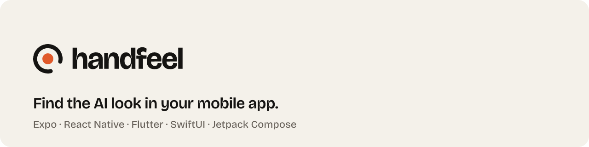
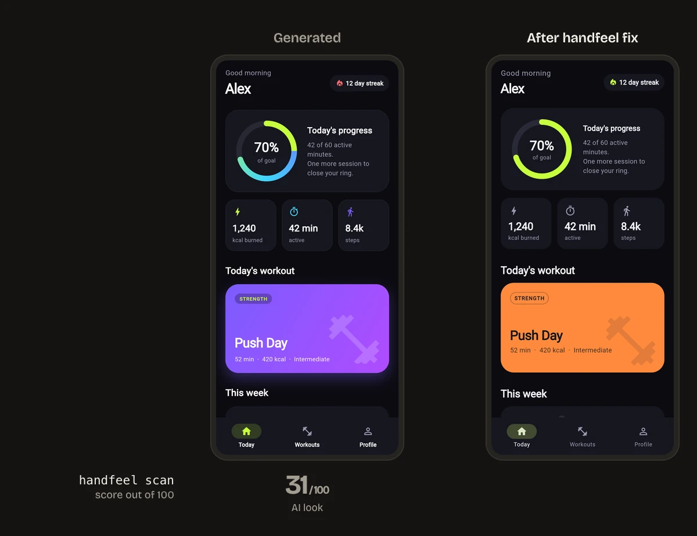
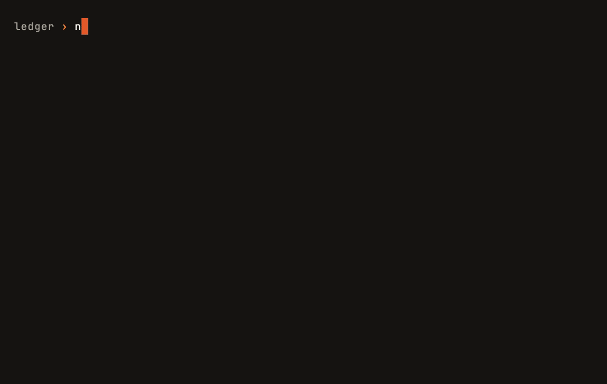
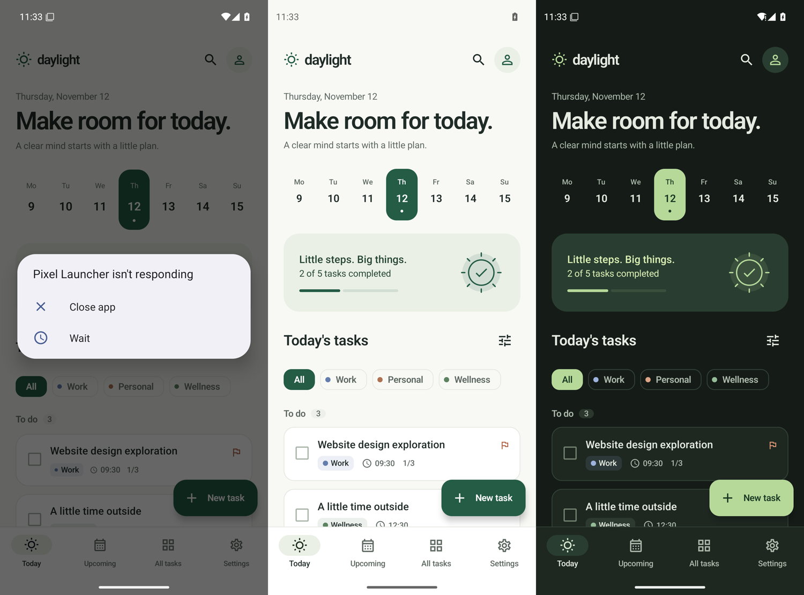

<p align="center">
  <picture>
    <source media="(prefers-color-scheme: dark)" srcset="brand/banners/readme-banner-dark.png">
    
  </picture>
</p>

<p align="center">
  一个给 Expo / React Native、Flutter、SwiftUI 和 Jetpack Compose 代码打 0 到 100 分的扫描器，<br>
  外加一个能把问题修掉的 Agent Skill。
</p>

<p align="center"><a href="README.md">English</a> · 简体中文</p>

<p align="center">
  
</p>

```sh
npx handfeel scan .          # 每条问题都带 file:line，不调用 AI，不联网
npx handfeel scan --demo     # 用一个 Claude 生成的 App 先试试
```

| Now in Android | Reply | Ice Cubes | Compass | Wonderous | Bluesky | Claude 和 Codex 生成的 App |
|---:|---:|---:|---:|---:|---:|---:|
| 94 | 92 | 91 | 87 | 85 | 76 | 31 到 79 |

AI 生成的 App 总在同样的地方出问题：点了没反馈、28 pt 的按钮、没有触感反馈、每个标签一个字号、夜里一片白屏，还有靛蓝色渐变。每条规则都引用 Apple HIG、Material 3 或框架文档，扫描器也[在九个开源 App 上校准过](docs/real-apps.md)，做得好的 App 不会被误伤。

## 让 Agent 来修

```sh
npx skills add maximilianfeix/handfeel        # Claude Code, Codex and other agents that read .agents/skills
npx handfeel init cursor                      # Cursor: writes .cursor/rules/handfeel.mdc
```

也可以作为 Claude Code 插件安装：先 `/plugin marketplace add maximilianfeix/handfeel`，再 `/plugin install handfeel@handfeel`。

装好后对 Agent 说 *"audit this app with handfeel"*（只出报告，每条问题带 `file:line`），或者 *"use handfeel to fix the screens"*（小步修改，一次一个页面、一个环节：触控、结构、颜色、字体、图标、间距、平台细节）。它不会删除任何功能、页面或流程，改导航或加依赖之前会先问你。

## 修什么

下面八个例子都摘自[平台参考文档](skills/handfeel/references/)。文档里每条规则都有反例、修法和引用来源。

**点了没反应**（Expo / React Native，`no-press-feedback`）

```diff
- <Pressable onPress={() => open(item)}>
+ <Pressable
+   onPress={() => open(item)}
+   android_ripple={{ color: c.ripple }}
+   style={({ pressed }) => ({ backgroundColor: pressed && Platform.OS === 'ios' ? c.highlight : 'transparent' })}
+ >
```

**渐变胶囊按钮配 `onTapGesture`**（SwiftUI，`no-press-feedback`）

```diff
- Text("Save")
-     .background(LinearGradient(colors: [.purple, .blue], startPoint: .leading, endPoint: .trailing))
-     .cornerRadius(16).shadow(radius: 10)
-     .onTapGesture { save() }
+ Button("Save", action: save)
+     .buttonStyle(.borderedProminent)
+     .controlSize(.large)
```

**只有 20 dp 的点击区域**（Jetpack Compose，`touch-target-too-small`）

```diff
- Icon(Icons.Default.Close, null, Modifier.size(20.dp).clickable { onClose() })
+ IconButton(onClick = onClose) {
+     Icon(Icons.Default.Close, contentDescription = stringResource(R.string.close))
+ }
```

**把表单塞进对话框**（Flutter，`modal-instead-of-sheet`）

```diff
- showDialog(context: context, builder: (_) => AlertDialog(content: form));
+ showModalBottomSheet(context: context, showDragHandle: true, useSafeArea: true,
+     isScrollControlled: true, builder: (_) => form);
```

**切换选项没有触感**（Flutter，`no-haptics`）

```diff
- GestureDetector(onTap: () => setState(() => selected = i), child: Segment(label))
+ InkWell(
+   onTap: () { HapticFeedback.selectionClick(); setState(() => selected = i); },
+   child: Segment(label),
+ )
```

**用 emoji 当图标**（Expo / React Native，`emoji-as-icon`）

```diff
- <Text style={{ fontSize: 22 }}>{'\u{1F3E0}'}</Text>   // house emoji as the Home tab icon
+ <SymbolView name={{ ios: 'house.fill', android: 'home' }} size={24} tintColor={c.text} />
```

**默认的紫色渐变**（Flutter，`purple-gradient`）

```diff
- gradient: LinearGradient(colors: [Color(0xFF667EEA), Color(0xFF764BA2)]),
+ color: Theme.of(context).colorScheme.surfaceContainerHigh,
```

**每个标签一个字号**（SwiftUI，`fixed-font-size`）

```diff
- Text("Good morning").font(.system(size: 34, weight: .ultraLight))
- Text(title).font(.custom("Inter-Bold", fixedSize: 28))
+ Text("Good morning").font(.largeTitle)
+ Text(title).font(.custom("Inter-Bold", size: 28, relativeTo: .title))
```

扫描器看不到的东西，Skill 也会管：层级、文案、空状态和加载状态、动效以及"减弱动态效果"设置。完整的特征清单见 [signs.md](skills/handfeel/references/signs.md)。

## 扫描器

<p align="center"></p>

```sh
npx handfeel scan .                 # score and every finding as file:line
npx handfeel scan --demo            # try it on a bundled generated Flutter app
npx handfeel scan . --card score.svg   # also write a 1200x630 score card to share
npx handfeel scan . --json          # or --sarif (GitHub code scanning), --md (PR comments)
npx handfeel rules                  # all 27 rules with weight and cap
npx handfeel explain no-haptics     # why the rule exists, how to fix it, sources
npx handfeel badge .                # a README badge with your score
```

想分享结果：`--card score.svg` 会生成一张 1200x630 的卡片，写着分数和扣分最多的三条规则；`npx handfeel badge .` 会输出一个可以放进 README 的徽章，比如 [](https://github.com/maximilianfeix/handfeel)。

它只读源码文件：不联网、不调用 AI、不执行任何代码。React Native 代码用 Babel AST 解析，Dart、Swift 和 Kotlin 用带测试的模式规则。同样的代码，每次扫出来的分数都一样。

```text
  handfeel 0.1.0  ·  Expo / React Native  ·  14 files

   51 / 100   looks generated

  where the points went
    -10  purple-gradient       2 found
    -10  no-dark-mode          1 found
   -9.5  hardcoded-color       19 found
     -8  no-press-feedback     4 found
     -6  glassmorphism         4 found, 1 free
     -3  type-scale-sprawl     11 found, 8 free
     -2  icon-button-no-label  2 found
      0  gradient-overuse      2 found, 2 free

  app/(tabs)/index.tsx
    32:7    purple-gradient       Gradient uses #8E5CF0, the indigo/violet band generated UIs default to.
    88:86   glassmorphism         rgba(255,255,255,0.3) is a frosted-glass fill.
  app/(tabs)/budgets.tsx
    85:7    icon-button-no-label  Pressable contains only an icon and has no accessibilityLabel.
    ...
```

### 分数怎么算

每条规则有单次扣分（weight）、扣分上限（cap），有的还有几次免扣额度（free）：

```text
score = floor(100 − Σ min(cap, weight × (count − free)))
```

超过 20 个文件的项目里，按出现次数计分的规则按每 20 个文件折算（`count × 20 / files`），因为权重是在小 App 上定的，2000 个文件的项目什么都会更多。项目级规则和关掉字体缩放不折算。

单条规则再吵也拉不垮总分，明细里能看到每一分扣在哪里。90 分及以上是 "feels native"，75 分以上 "almost there"，50 分以上 "looks generated"，再往下是 "AI look"。100 分只说明扫描器没找到它认识的问题，不代表这个 App 设计得好。

### 真实 App 的得分

九个知名开源 App，2026-11-12 按 [docs/real-apps.md](docs/real-apps.md) 中的 commit 扫描，那里也逐条说明了剩下的问题是否合理。

| App | 平台 | 得分 |
|---|---|---:|
| [Now in Android](https://github.com/android/nowinandroid) | Jetpack Compose | 94 |
| [Reply](https://github.com/android/compose-samples) | Jetpack Compose | 92 |
| [Ice Cubes](https://github.com/Dimillian/IceCubesApp) | SwiftUI | 91 |
| [Compass](https://github.com/flutter/samples) | Flutter | 87 |
| [Wonderous](https://github.com/gskinnerTeam/flutter-wonderous-app) | Flutter | 85 |
| [Immich](https://github.com/immich-app/immich)（移动端） | Flutter | 80 |
| [Jetchat](https://github.com/android/compose-samples) | Jetpack Compose | 80 |
| [Expensify](https://github.com/Expensify/App) | React Native | 79 |
| [Bluesky](https://github.com/bluesky-social/social-app) | Expo / React Native | 76 |

校准之前，同一套规则给 Bluesky 打 11 分、Immich 打 22 分，主要是误报（主题文件、SVG 插图、遮罩层）以及大项目把每条规则都扣到上限。这些都已修复并配了测试用例。剩下的大多是真问题：Expensify 在共用的 Text 组件里关掉了字体缩放，Immich 有 57 个没有 tooltip 的图标按钮。

### 接入 CI

分数低于阈值就让构建失败，或者把结果上传到 GitHub code scanning：

```yaml
- run: npx handfeel scan . --min-score 80
- run: npx handfeel scan . --sarif > handfeel.sarif
- uses: github/codeql-action/upload-sarif@v3
  with:
    sarif_file: handfeel.sarif
```

### 忽略某条结果

在上一行加注释即可，TypeScript、Dart、Swift 和 Kotlin 都适用：

```ts
// handfeel-ignore-next-line hardcoded-color
```

`handfeel-ignore-line` 和 `handfeel-ignore-file` 用法相同。不写规则 id 就忽略所有规则。其他选项：`--ignore "legacy/**"`、`--only`、`--disable`。

## 平台支持

| | Expo / React Native | Flutter | SwiftUI | Jetpack Compose |
|---|---|---|---|---|
| 扫描规则数 | 21 | 20 | 14 | 16 |
| Skill：审查（audit） | 支持 | 支持 | 支持 | 支持 |
| Skill：修复（fix） | 支持，已评测 | 支持，已评测 | 支持，已评测 | 支持，已评测 |
| 评测中修复的生成 App | 3 | 2 | 1 | 1 |
| 修复后的检查 | 类型检查、Expo Web | `flutter analyze`、CI 中的 Web 构建 | CI 中 Xcode 构建、iOS 模拟器 | CI 中 Gradle 构建、Android 模拟器 |
| 校准用的真实 App | 2 | 3 | 1 | 3 |

目前还没有在真机上跑过。两种安装方式已于 2026-11-12 在全新项目里实测：Claude Code 会自动识别这个 Skill，Codex 能列出它；按 Cursor 文档，Cursor 也会读取 `.agents/skills`，但还没在 Cursor 里实际跑过。欢迎反馈真机和 Cursor 的使用情况，见 [CONTRIBUTING.md](CONTRIBUTING.md)。

## 规则从哪来

每条规则至少引用一个来源，`handfeel explain <rule>` 会把来源打印出来。大部分来自 [Apple 人机界面指南](https://developer.apple.com/design/human-interface-guidelines)、[Material 3](https://m3.material.io)，以及 Android、React Native、Expo、Flutter 和 SwiftUI 的官方文档，原文引用写在[参考文档](skills/handfeel/references/)里。全部 56 个来源链接见 [docs/sources.md](docs/sources.md)。

有些特征没有官方规则可依：没有哪份平台文档禁止用 emoji 当图标，或者用紫色当主色。这些规则引用的是 [slop catalog](docs/slop-catalog.md)：2026-11-12 用普通提示词生成 7 个 App，再统计扫描结果：

| 特征 | App 数 |
|---|---:|
| 页面里写死颜色值 | 7 / 7 |
| 间距不在 4 点网格上 | 6 / 7 |
| 点击没有视觉反馈 | 5 / 7 |
| 字号太多 | 4 / 7 |
| 完全没有触感反馈 | 4 / 7 |
| 缺少深色模式或强制单一模式 | 4 / 7 |
| 出现靛蓝到紫色的颜色 | 3 / 7 |

7 个 App 是很小的样本，这些数字只代表这 7 个 App。

## 评测

七个 App 用普通的提示词生成，每个平台至少一个（四个由 Claude Sonnet 5.5 生成，三个由 Codex 里的 gpt-6.1-sol 生成）。然后由一个全新的 Agent 以 fix 模式对每个 App 运行这个 Skill，不给其他上下文。最后一列是把所有忽略注释关掉后重新打的分，被压下去的问题照样计分。

| App | 平台 | 修复前 | 修复后 | 关掉忽略注释后 |
|---|---|---:|---:|---:|
| expo-budget | Expo | 51 | 100 | 100 |
| expo-chat | Expo | 38 | 100 | 95 |
| expo-habits | Expo | 71 | 100 | 100 |
| flutter-fitness | Flutter | 31 | 100 | 100 |
| flutter-meditation | Flutter | 60 | 100 | 100 |
| swiftui-recipes | SwiftUI | 79 | 100 | 100 |
| compose-tasks | Jetpack Compose | 77 | 100 | 100 |
| **平均** | | **58** | **100** | **99** |

修复的 Agent 能运行扫描器，所以高分在一定程度上只说明它照着扫描器改了。扫描器作不了弊的检查有：修复没有在它写的代码里引入类型错误；Flutter 的 `lib/` 修复前后都是 0 个错误、0 个警告；SwiftUI App 在 CI 里用 Xcode 构建成功，Compose App 用 Gradle 构建成功；所有 App 都在浏览器、模拟器或 Android 模拟器里以浅色和深色模式打开看过。



方法、提示词、diff、构建检查、每个 App 的截图以及没测到的部分，见 [docs/evals.md](docs/evals.md)。

## 和同类项目比较

handfeel 的起点是 [heydamir 的 Unslopping 系列](https://x.com/heydamir/status/2115063463063998736)和 [unslop](https://github.com/heydamir/unslop)：把一个生成出来的页面按固定顺序一轮轮打磨，直到它看起来像是设计过的。这个思路来自那里。Web 端已经有不错的工具，handfeel 把同样的事情搬到了原生 App 的源码上。

| | 面向 | 静态扫描器 | 确定性评分 |
|---|---|---|---|
| [unslop](https://github.com/heydamir/unslop) | Web 界面：仪表盘、落地页 | 无 | 无 |
| [impeccable](https://github.com/pbakaus/impeccable) | Web，附带原生审查指南 | `npx impeccable detect`，仅限 Web | 无（`critique` 是由模型打分的评审） |
| [hallmark](https://github.com/Nutlope/hallmark) | Web 界面和落地页，50 套主题 | `sloplint`（静态检查，可选浏览器渲染），仅 Web | 无 |
| [Appllama skills](https://github.com/Appllama/appllama-skills) | Expo / React Native 设计，付费 MCP 组件库 | 无 | 无 |
| [unslopovich](https://github.com/erkamyaman/unslopovich) | 移动端 Skill，覆盖多种技术栈 | 无（`npx` 用来安装 Skill） | 无 |
| [flutter-unslop](https://github.com/MBotirjonDev/flutter-unslop) | Flutter | 有，仅 Flutter | 0-100 slop 分 |
| [unslop-design](https://github.com/marcosnovo/unslop-design) | SwiftUI、Compose、Web | Python 脚本 | 0-100 |
| handfeel | Expo / RN、Flutter、SwiftUI、Compose | `npx handfeel scan`，扫描原生源码 | 0-100 |

impeccable 和 handfeel 最接近。它的 `audit` 和 `adapt` 命令有原生版本，可以读 SwiftUI、Compose、React Native 和 Flutter 源码，但它的 README 写明 ["the detector, live mode … and the edit hook stay web-only"](https://github.com/pbakaus/impeccable#good-to-know)。做 Web 就用这三个。做手机 App，上面这些 Skill 都值得一用；handfeel 多出来的是：一个覆盖四种技术栈的确定性扫描器，在九个开源 App 上校准过，每个发现的误报都有对应的测试用例，而且每条规则都标明出处。

## 参与贡献

最有用的贡献是新规则。一条规则需要：一个你在生成代码里见过的模式、修法、来源，以及一对正反例 fixture。[CONTRIBUTING.md](CONTRIBUTING.md) 里有完整步骤，可以从标了 [good first issue](https://github.com/maximilianfeix/handfeel/labels/good%20first%20issue) 的 issue 开始。误报同样欢迎反馈：附上代码片段[提交误报](https://github.com/maximilianfeix/handfeel/issues/new?template=false-positive.yml)。

## Star 趋势

<a href="https://star-history.com/#maximilianfeix/handfeel&Date"></a>

## 许可证

[MIT](LICENSE) © Maximilian Feix
