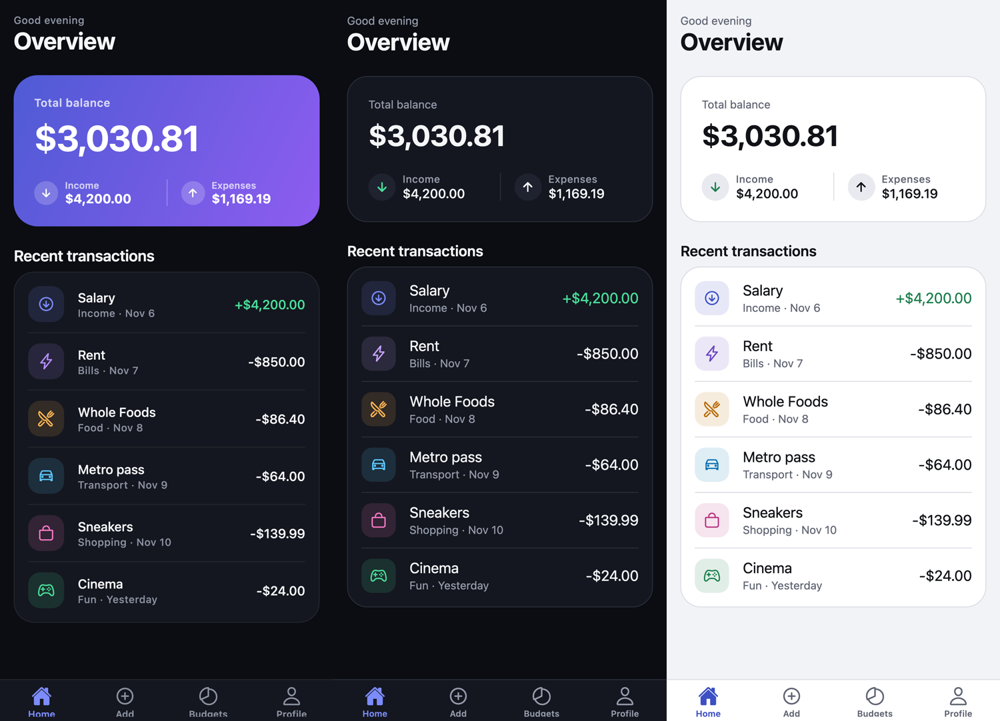
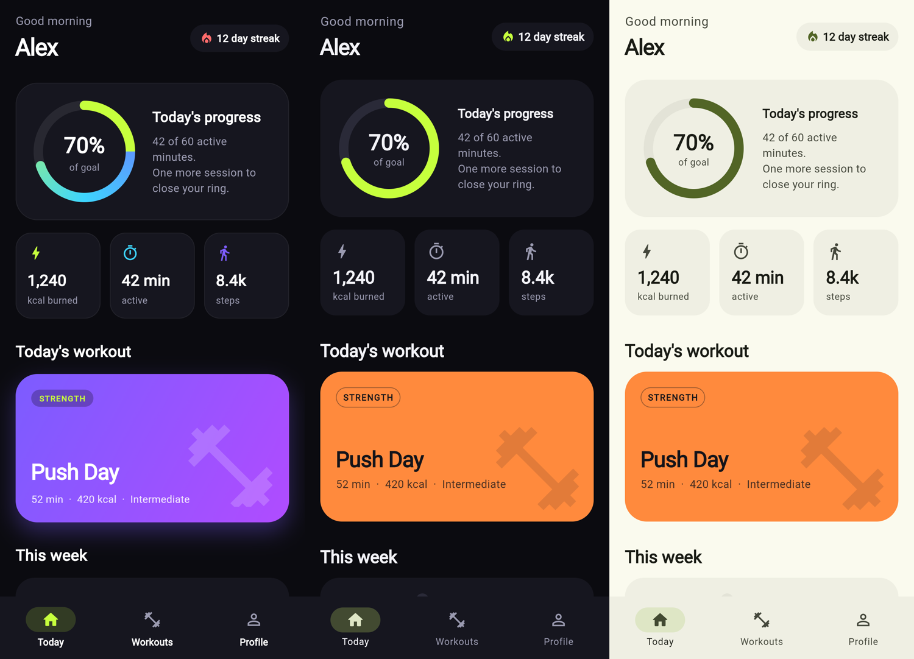
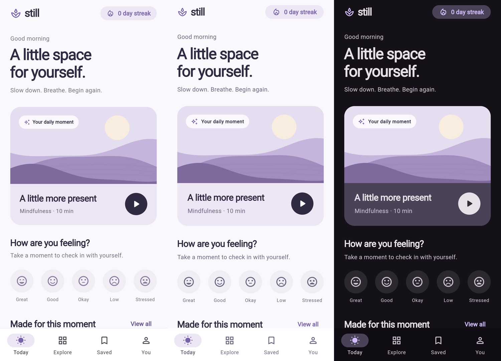
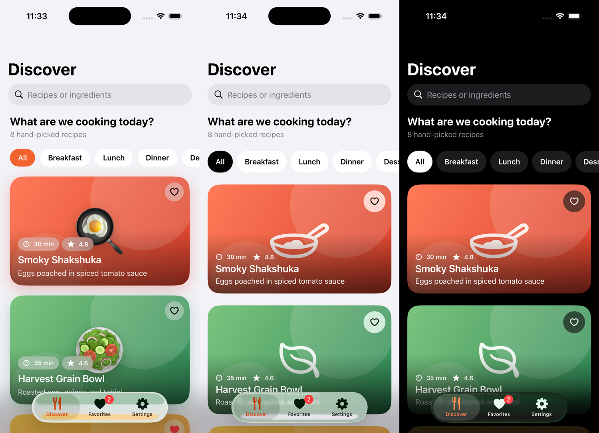
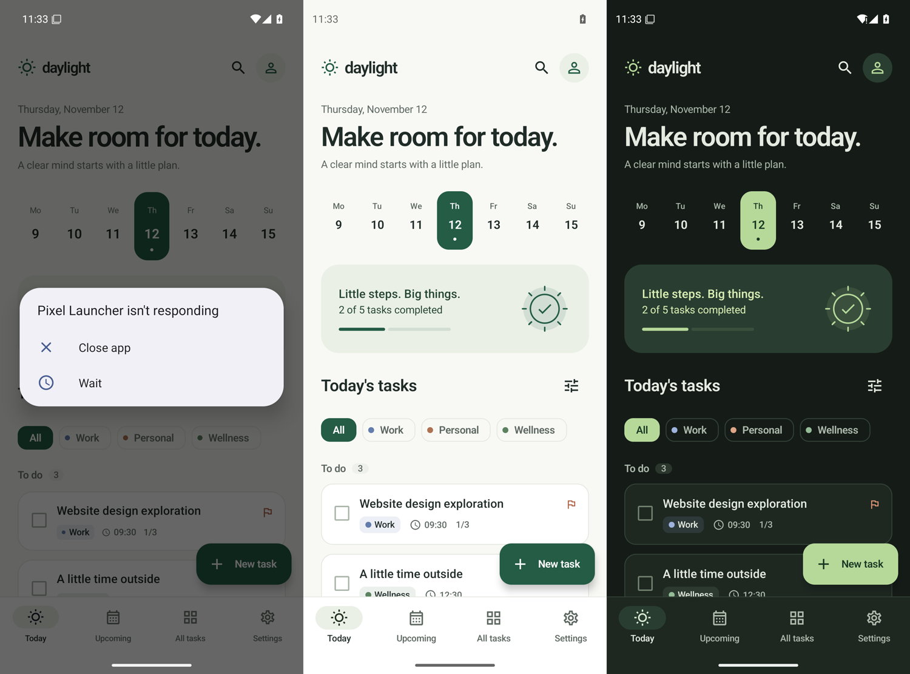

# Evals

Does `handfeel fix` make generated apps better, and does it break them? Measured on 2026-11-12.

## Method

1. **Generate.** Seven apps were generated from plain prompts in empty folders: four by Claude Sonnet 5.5 (Claude Code subagent), three by OpenAI gpt-6.1-sol (Codex CLI 0.163.0). The prompts asked for a "modern", "beautiful", "premium" or "polished" app, as people do, and said nothing about design rules. The output is committed unchanged in `evals/apps/<app>/before`, with the prompt in `PROMPT.md`.
2. **Fix.** For each app a fresh Claude Opus 5.5 agent got one instruction: use the skill at `skills/handfeel/SKILL.md` on this folder, fix mode, don't ask questions. It saw nothing else from this repo. The result is committed in `after/`, with a summary of the agent's report in `FIX-REPORT.md`.
3. **Score.** `node scripts/evals.mjs` scans `before` and `after`, and scans `after` a second time with every `handfeel-ignore` comment disabled, so suppressed findings still count. Results: `evals/results.json`.
4. **Check what the score can't see.** The fixing agents could run the scanner, so a high score partly measures that they followed it. Three checks it cannot game: the code still type-checks or analyzes, the screens still render, and a person looks at them.

## Scores

| App | Platform | Generated by | Before | After | After, ignores disabled | Diff |
|---|---|---|---:|---:|---:|---|
| expo-budget | Expo | Claude Sonnet 5.5 | 51 | 100 | 100 | 13 files, +369 −189 |
| expo-chat | Expo | gpt-6.1-sol (Codex) | 38 | 100 | 95 | 17 files, +388 −239 |
| expo-habits | Expo | Claude Sonnet 5.5 | 71 | 100 | 100 | 8 files, +431 −164 |
| flutter-fitness | Flutter | Claude Sonnet 5.5 | 31 | 100 | 100 | 13 files, +621 −560 |
| flutter-meditation | Flutter | gpt-6.1-sol (Codex) | 60 | 100 | 100 | 9 files, +226 −132 |
| swiftui-recipes | SwiftUI | Claude Sonnet 5.5 | 79 | 100 | 100 | 7 files, +181 −122 |
| compose-tasks | Jetpack Compose | gpt-6.1-sol (Codex) | 77 | 100 | 100 | 6 files, +262 −109 |
| **Mean** | | | **58** | **100** | **99** | |

Scores are recomputed with the current scanner every time `scripts/evals.mjs` runs. flutter-fitness showed 38 when its agent started; a later fix to `no-dark-mode` (a single dark theme used to count as dark-mode support) lowered the before score to 28. The calibration on real apps ([real-apps.md](real-apps.md)) moved the before scores up by 0-3 points (sizes defined in a theme no longer count as type-scale sprawl, named palette entries no longer count as hard-coded colors); flutter-fitness is now 31. The after scores did not change.

A score of 100 means the scanner finds nothing it knows how to find. It does not mean the app is well designed. The scanner has 27 rules; hierarchy, copy, motion and empty states are left to the skill and to people.

expo-chat's agent added four ignore comments and explained each in its report: two keyboard findings it judged false positives (fields inside a component that already avoids the keyboard), one Modal it used to build the Android bottom sheet, and one dimmed backdrop that should not look pressable. Disabling them gives 95: since the calibration the scanner itself skips the backdrop and one of the two keyboard findings.

## Does it still build?

| App | Check | Before | After |
|---|---|---|---|
| expo-budget | `tsc --noEmit` | 0 errors | 0 errors |
| expo-chat | `tsc --noEmit` | 2 errors | 3 errors |
| expo-habits | `tsc --noEmit` | 1 error | 1 error |
| flutter-fitness | `flutter analyze lib` (Flutter 3.50.0, CI) | 0 errors, 0 warnings, 32 infos | 0 errors, 0 warnings, 19 infos |
| flutter-meditation | `flutter analyze lib` (Flutter 3.50.0, CI) | 0 errors, 0 warnings, 12 infos | 0 errors, 0 warnings, 11 infos |
| swiftui-recipes | `xcodebuild` for the iOS simulator (Xcode 26.6, CI) | BUILD SUCCEEDED | BUILD SUCCEEDED |
| compose-tasks | `gradle :app:assembleDebug` (Gradle 8.14.3, AGP 8.9.2, CI) | BUILD SUCCESSFUL | BUILD SUCCESSFUL |

TypeScript ran against one shared install of Expo SDK 52 / React Native 0.76 types. The errors that appear before and after are environment errors: `@react-native-async-storage/async-storage` is not in that install, and expo-chat has an implicit `any` the generator wrote. The one new error in expo-chat is `navigationBarTranslucent` on `Modal`, a prop missing from the 0.76 types used for the check; the app itself declares React Native 0.81. No fix introduced a type error in code it wrote.

All four Flutter variants build for web in CI (`.github/workflows/evals.yml`).

## What it looks like

Screens rendered from the committed code: Expo apps on Expo Web (390×844, @3x), Flutter apps from the CI web build. Before on the left, after in dark and light.







## SwiftUI and Compose

Both apps are built in CI before and after, then launched in a simulator or emulator in light and dark mode (`.github/workflows/swiftui.yml`, `compose.yml`).

swiftui-recipes (generated by Claude Sonnet 5.5, iOS simulator): the dish emoji became SF Symbols, the favourite button grew from 38 to 44 pt, the selected chip no longer puts white text on orange (3.2:1), and `.onTapGesture` steps became buttons. The emoji art was arguably more fun to look at; the symbols follow the system and the text size.



compose-tasks (generated by gpt-6.1-sol, Android emulator, API 35): the app had a dark scheme behind an in-app switch that defaulted to off, so it ignored the phone's setting (the scanner learned to flag this the same day; see `no-dark-mode`). After the fix it follows the system, and every Material color role is set, so dialogs and menus no longer fall back to the default purple. The emulator showed a launcher ANR dialog on the before run in light mode, so the before panel is the before run in dark mode, which looks the same because that app ignored the setting.



## What was not tested

- None of the apps was run on a physical device. The hero demo in the README says which parts were recorded on the Android emulator and which on Expo Web (docs/assets/HERO.md).
- Haptics, ripples and sheets cannot be judged from a screenshot.
- Seven apps, one fixing model, one run each. The SwiftUI and Compose apps were fixed later the same day by one agent that handled both, briefed the same way. Another run would produce different code and possibly different scores.

## Reproduce

```sh
npm ci && npm run build
node scripts/evals.mjs        # scores, writes evals/results.json
node scripts/catalog.mjs      # rule frequencies in the generated apps, writes docs/slop-catalog.md
```
